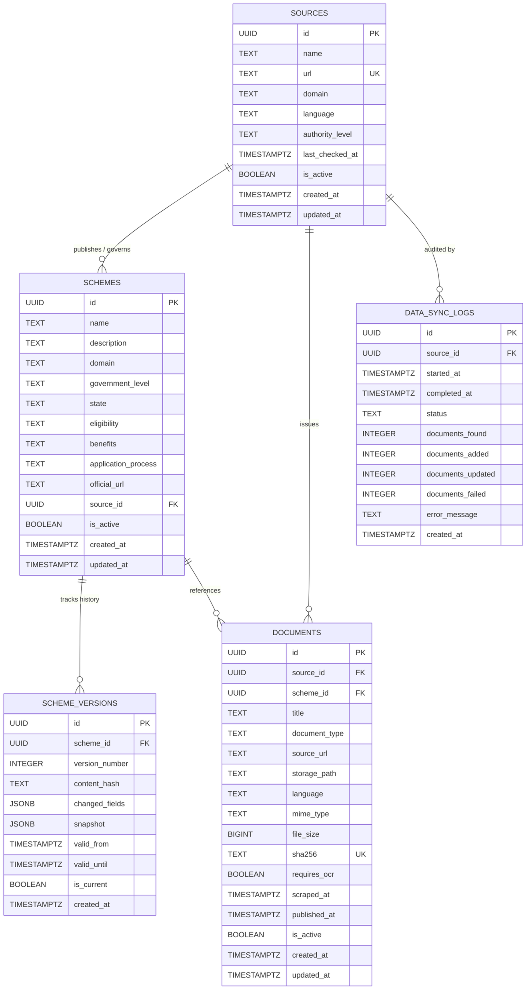

# NEXO Data Platform - Database Schema & Architecture

This document describes the PostgreSQL database architecture for the **NEXO Data Platform**, the data foundation for verified multilingual government schemes, circulars, legal assistance, and rural sustainability information.

---

## 1. High-Level Entity-Relationship Diagram (ERD)



---

## 2. Core Tables Data Dictionary

### Table 1: `sources`
Tracks verified official government portals, department sites, and ministry registries.

| Column | Type | Constraints | Description |
| :--- | :--- | :--- | :--- |
| `id` | `UUID` | `PRIMARY KEY DEFAULT gen_random_uuid()` | Unique source identifier |
| `name` | `TEXT` | `NOT NULL` | Human-readable name of ministry/department |
| `url` | `TEXT` | `NOT NULL UNIQUE` | Official base or portal URL |
| `domain` | `TEXT` | `NOT NULL` | Core NEXO domain classification |
| `language` | `TEXT` | `NOT NULL DEFAULT 'en'` | Default language of the portal |
| `authority_level` | `TEXT` | `NOT NULL` | Administrative tier (`central`, `state`, `district`, `local`) |
| `last_checked_at`| `TIMESTAMPTZ` | `NULL` | Timestamp of the most recent scraper check |
| `is_active` | `BOOLEAN` | `NOT NULL DEFAULT true` | Operational toggle for scraping/querying |
| `created_at` | `TIMESTAMPTZ` | `NOT NULL DEFAULT now()` | Record creation timestamp |
| `updated_at` | `TIMESTAMPTZ` | `NOT NULL DEFAULT now()` | Managed automatically by trigger |

**Indexes:**
* `idx_sources_domain` on `(domain)`
* `idx_sources_language` on `(language)`
* `idx_sources_authority_level` on `(authority_level)`
* `idx_sources_is_active` on `(is_active)`

---

### Table 2: `schemes`
Structured records of welfare schemes, subsidies, programs, and legal/financial entitlements.

| Column | Type | Constraints | Description |
| :--- | :--- | :--- | :--- |
| `id` | `UUID` | `PRIMARY KEY DEFAULT gen_random_uuid()` | Unique scheme identifier |
| `name` | `TEXT` | `NOT NULL` | Official scheme title |
| `description` | `TEXT` | `NULL` | Detailed summary and objectives |
| `domain` | `TEXT` | `NOT NULL` | One of the 7 NEXO focus domains |
| `government_level`| `TEXT` | `NOT NULL` | `central` or `state` |
| `state` | `TEXT` | `NULL` | State name for state-specific schemes; `NULL` for central |
| `eligibility` | `TEXT` | `NULL` | Target criteria, exclusions, and qualifications |
| `benefits` | `TEXT` | `NULL` | Subsidies, financial transfers, or non-monetary aid |
| `application_process` | `TEXT` | `NULL` | How citizens apply (online portal, CSC, nodal office) |
| `official_url` | `TEXT` | `NOT NULL` | Official landing page or scheme notification link |
| `source_id` | `UUID` | `REFERENCES sources(id) ON DELETE SET NULL` | Sponsoring source portal |
| `is_active` | `BOOLEAN` | `NOT NULL DEFAULT true` | Active flag |
| `created_at` | `TIMESTAMPTZ` | `NOT NULL DEFAULT now()` | Ingestion timestamp |
| `updated_at` | `TIMESTAMPTZ` | `NOT NULL DEFAULT now()` | Managed automatically by trigger |

**Indexes:**
* `idx_schemes_domain` on `(domain)`
* `idx_schemes_government_level` on `(government_level)`
* `idx_schemes_state` on `(state)` (partial index where `state IS NOT NULL`)
* `idx_schemes_source_id` on `(source_id)`
* `idx_schemes_is_active` on `(is_active)`

---

### Table 3: `scheme_versions`
Audit log and point-in-time state management for all modifications to government schemes.

| Column | Type | Constraints | Description |
| :--- | :--- | :--- | :--- |
| `id` | `UUID` | `PRIMARY KEY DEFAULT gen_random_uuid()` | Unique version record ID |
| `scheme_id` | `UUID` | `NOT NULL REFERENCES schemes(id) ON DELETE CASCADE` | Linked scheme |
| `version_number` | `INTEGER` | `NOT NULL` | Monotonically increasing revision number (1, 2, ...) |
| `content_hash` | `TEXT` | `NOT NULL` | SHA-256 hash of normalized scheme fields |
| `changed_fields` | `JSONB` | `DEFAULT '{}'::jsonb` | Delta key-value pairs showing changed fields |
| `snapshot` | `JSONB` | `NOT NULL` | Full state of the scheme at this version |
| `valid_from` | `TIMESTAMPTZ` | `NOT NULL DEFAULT now()` | When this version took effect |
| `valid_until` | `TIMESTAMPTZ` | `NULL` | When superseded by a newer version |
| `is_current` | `BOOLEAN` | `NOT NULL DEFAULT true` | Flag denoting the latest active version |
| `created_at` | `TIMESTAMPTZ` | `NOT NULL DEFAULT now()` | Version creation timestamp |

**Unique Constraint:**
* `uq_scheme_versions_scheme_version` on `(scheme_id, version_number)`

**Indexes:**
* `idx_scheme_versions_scheme_id` on `(scheme_id)`
* `idx_scheme_versions_is_current` on `(is_current)`
* `idx_scheme_versions_content_hash` on `(content_hash)`

---

### Table 4: `documents`
Metadata and storage pointers for official circulars, guidelines, application forms, and PDFs.

| Column | Type | Constraints | Description |
| :--- | :--- | :--- | :--- |
| `id` | `UUID` | `PRIMARY KEY DEFAULT gen_random_uuid()` | Unique document identifier |
| `source_id` | `UUID` | `REFERENCES sources(id) ON DELETE SET NULL` | Origin portal |
| `scheme_id` | `UUID` | `REFERENCES schemes(id) ON DELETE SET NULL` | Associated scheme (optional) |
| `title` | `TEXT` | `NOT NULL` | Official document title |
| `document_type` | `TEXT` | `NULL` | `guideline`, `gazette`, `circular`, `form`, etc. |
| `source_url` | `TEXT` | `NOT NULL` | Public URL where the document was downloaded |
| `storage_path` | `TEXT` | `NULL` | Bucket path in Supabase Storage |
| `language` | `TEXT` | `NOT NULL DEFAULT 'en'` | Document language code (ISO 639-1 / BCP 47) |
| `mime_type` | `TEXT` | `NULL` | e.g., `application/pdf`, `text/html` |
| `file_size` | `BIGINT`| `NULL` | Size in bytes |
| `sha256` | `TEXT` | `NOT NULL UNIQUE` | Cryptographic checksum for deduplication & integrity |
| `requires_ocr` | `BOOLEAN` | `NOT NULL DEFAULT false` | Set true for scanned PDFs / raster images |
| `scraped_at` | `TIMESTAMPTZ` | `NULL` | When the crawler discovered the file |
| `published_at` | `TIMESTAMPTZ` | `NULL` | Date published by the government authority |
| `is_active` | `BOOLEAN` | `NOT NULL DEFAULT true` | Active / archived status |
| `created_at` | `TIMESTAMPTZ` | `NOT NULL DEFAULT now()` | Ingestion timestamp |
| `updated_at` | `TIMESTAMPTZ` | `NOT NULL DEFAULT now()` | Managed automatically by trigger |

**Indexes:**
* `idx_documents_source_id` on `(source_id)`
* `idx_documents_scheme_id` on `(scheme_id)`
* `idx_documents_sha256` on `(sha256)`
* `idx_documents_language` on `(language)`
* `idx_documents_is_active` on `(is_active)`
* `idx_documents_requires_ocr` on `(requires_ocr)` (partial where `requires_ocr = true`)

---

### Table 5: `data_sync_logs`
Operational telemetry for web scrapers, API fetchers, and synchronization jobs.

| Column | Type | Constraints | Description |
| :--- | :--- | :--- | :--- |
| `id` | `UUID` | `PRIMARY KEY DEFAULT gen_random_uuid()` | Unique log identifier |
| `source_id` | `UUID` | `REFERENCES sources(id) ON DELETE SET NULL` | Target source synced |
| `started_at` | `TIMESTAMPTZ` | `NOT NULL DEFAULT now()` | Sync commencement timestamp |
| `completed_at` | `TIMESTAMPTZ` | `NULL` | Sync completion timestamp |
| `status` | `TEXT` | `NOT NULL` | `in_progress`, `completed`, `failed`, `partial` |
| `documents_found` | `INTEGER` | `DEFAULT 0` | Total links/documents identified |
| `documents_added` | `INTEGER` | `DEFAULT 0` | New documents stored |
| `documents_updated` | `INTEGER` | `DEFAULT 0` | Existing documents updated |
| `documents_failed` | `INTEGER` | `DEFAULT 0` | Scrape or extraction errors |
| `error_message` | `TEXT` | `NULL` | Stack trace or failure description |
| `created_at` | `TIMESTAMPTZ` | `NOT NULL DEFAULT now()` | Log creation timestamp |

**Indexes:**
* `idx_data_sync_logs_source_id` on `(source_id)`
* `idx_data_sync_logs_status` on `(status)`
* `idx_data_sync_logs_started_at` on `(started_at DESC)`

---

## 3. Supported Domains

All records categorize into the 7 core NEXO domains:

1. **Government Schemes** (Welfare programs, direct benefit transfers, pensions)
2. **Cooperative Governance** (Primary Agricultural Credit Societies (PACS), cooperative bylaws)
3. **Agriculture and Rural Sustainability** (Crop insurance, soil health, solar irrigation)
4. **FoodTech / Cold-chain / Rural Logistics** (Food processing subsidies, warehouse infrastructure)
5. **Rural Development and Financial Assistance** (SHG credit, livelihood missions, housing)
6. **Legal Assistance / Grievance Redressal** (Lok Adalats, land dispute mechanisms, consumer rights)
7. **Multilingual Government Information** (Cross-cutting multilingual statutory notifications)

---

## 4. Ingestion Pipeline & Data Integrity Lifecycle

```
[Official Source URL]
       │
       ▼
[Source Registry (sources)]
       │
       ▼
[Scraper / Sync Agent (data_sync_logs)]
       │
       ▼
[Raw Document Download] ──► [Compute SHA-256 Checksum]
                                   │
                    ┌──────────────┴──────────────┐
                    │ Duplicate SHA-256?          │
                    │ YES ──► Skip download       │
                    │ NO  ──► Proceed             │
                    └──────────────┬──────────────┘
                                   ▼
                        [Format & Text Extraction]
                                   │
                    ┌──────────────┴──────────────┐
                    │ Scanned / Raster Image?     │
                    │ YES ──► Set requires_ocr    │
                    │ NO  ──► Parse text          │
                    └──────────────┬──────────────┘
                                   ▼
                        [Structured Validation]
                                   │
       ┌───────────────────────────┼───────────────────────────┐
       ▼                           ▼                           ▼
[Store Metadata]           [Upload Binary]           [Scheme Versioning]
(documents table)          (Supabase Storage)        (Compute content_hash)
                                                               │
                                                   [schemes & scheme_versions]
                                                               │
                                                               ▼
                                                    [Future Embeddings / RAG]
```

---

## 5. Security & Row Level Security (RLS)

* **All 5 tables have Row Level Security enabled.**
* **Public Access (`anon`, `authenticated`)**:
  * Read-only access (`SELECT`) to active records (`is_active = true` or `is_current = true`).
  * Direct writes (`INSERT`, `UPDATE`, `DELETE`) are denied.
* **Pipeline / Admin Access (`service_role`)**:
  * Full access (`ALL`) for data ingestion, scraper logging, and scheme updates.

---

## 6. How to Apply Migrations

### Via Supabase Dashboard (Recommended)
1. Open your Supabase project dashboard: [NEXO-Data-Platform](https://supabase.com/dashboard).
2. Navigate to **SQL Editor** in the left sidebar.
3. Open `scripts/migrations/001_initial_schema.sql` from this repository.
4. Paste the SQL into the editor and click **Run**.

### Via Supabase CLI
```bash
supabase db push
# or
supabase migration up
```
