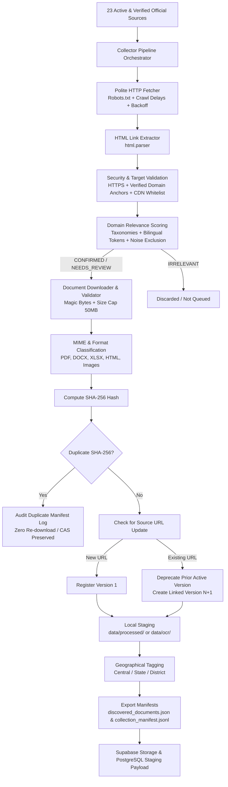

# NEXO Data Platform - Document Discovery & Collector Pipeline

This document describes the design, architecture, security controls, relevance heuristics, crawling politeness, and operational workflows of the **Document Discovery & Collector Pipeline** for the **NEXO Data Platform**.

---

## 1. Pipeline Overview & Objective

The **Document Discovery & Collector Pipeline** is NEXO's authoritative intake engine. It bridges verified official government portals to NEXO's immutable storage and structured database.

### Core Pipeline Flow



---

## 2. Key Architecture Principles

### Zero Unverified Trust
- The collector **only** starts crawling from sources in `data/manifests/sources/verified_sources.json` that have:
  - `verification_status == "VERIFIED"`
  - `is_active == True`
- Candidate sources in `PENDING`, `NEEDS_REVIEW`, or `REJECTED` states are strictly skipped.

### Security & Scope Guardrails (`app/collector/security.py`)
- **Protocol Enforcement**: Only `http` and `https` schemes are accepted. Any file, javascript, or mailto links are dropped.
- **Domain Anchoring**: By default, the crawler restricts links to the source's own domain and authorized official government CDNs (`s3waas.gov.in`, `egazette.gov.in`, `digitalindia.gov.in`, `nic.in`, `gov.in`).
- **Path Traversal Protection**: Relative paths with `../` or encoded traversal sequences are neutralized.
- **SSRF & Private Network Mitigation**: Restricts requests to public government hostnames.

### Crawling Politeness & Resilience (`app/collector/polite_client.py`)
- **Rate Limiting**: Host-aware delays (default 1.0s between requests to the same domain) prevent unintentional load on government servers.
- **Polite User-Agent**: Identifies itself as `NEXO-DataPlatform-Collector/1.0 (+https://github.com/nexo/data-platform; official data ingestion bot)`.
- **`robots.txt` Compliance**: Queries and respects `Disallow` rules for user-agent `*` or `NEXO-DataPlatform-Collector`.
- **Content Size Guard**: Documents exceeding 50 MB are halted before memory exhaustion.
- **Exponential Backoff**: Up to 3 retries on transient network errors (HTTP 429, 502, 503, 504).

---

## 3. Domain Relevance & Noise Filtering (`app/collector/relevance.py`)

To ensure that only high-value government information is ingested, every discovered candidate URL and anchor text is evaluated against domain-specific taxonomies and bilingual (English + Tamil + Hindi) keywords.

### The 7 NEXO Domains & Taxonomies

| Domain | Focus Areas | Key Indicators |
|---|---|---|
| `government_schemes` | Central & State welfare initiatives, beneficiary eligibility | scheme, yojana, thittam, eligibility, guidelines, subsidy |
| `cooperative_governance` | PACS, credit cooperatives, MSCS, bylaws, elections | pacs, cooperative, sangam, society, bylaws, mscs |
| `agriculture_rural_sustainability` | Soil health, FPO, organic farming, MSP, irrigation | kisan, fpo, soil, organic, agriculture, msp, krishi |
| `foodtech_coldchain` | Cold storages, food processing, agri-logistics, APEDA, FSSAI | cold chain, processing, warehousing, logistics, fssai, apeda |
| `rural_development_finance` | Rural livelihood, microfinance, SHGs, NABARD, NRLM | nrlm, nabard, livelihood, shg, microfinance, gramin |
| `legal_assistance` | Lok Adalat, legal aid, NALSA, mediation, grievance redressal | lok adalat, legal aid, nalsa, grievance, cpgrams, mediation |
| `multilingual_gov_info` | Translated circulars, state gazettes, multilingual portals | tamil, hindi, gazette, translated, multilingual, arasithazh |

### Administrative Noise Exclusion
Standard web boilerplate is immediately filtered out:
- Contact Us, Feedback, Tender Tenders, Archive
- Login, Register, Captcha, Screen Reader Access
- Skip to Main Content, Sitemap, Privacy Policy, Terms of Use

### Tri-State Relevance Outcome
- **`CONFIRMED`** (Score $\ge 5$): Directly aligned document or guideline. Staged for automated download.
- **`NEEDS_REVIEW`** (Score $2 - 4$): Borderline document or circular. Staged with verification flag.
- **`IRRELEVANT`** (Score $< 2$): Non-NEXO content. Ignored.

---

## 4. Download Validation & Immutability (`app/collector/downloader.py`)

### Magic-Byte Format Detection
Never trust the file extension or the `Content-Type` header alone. Many Indian government portals serve HTML 404 pages with a `.pdf` extension.
- **PDF**: Checks for leading `%PDF-` bytes.
- **DOCX / XLSX**: Checks for ZIP archive magic bytes `PK\x03\x04` and verifies payload contents.
- **HTML**: Checks for `<!DOCTYPE html` or `<html` tags.
- **Images**: Checks for JPEG (`\xFF\xD8\xFF`), PNG (`\x89PNG`), TIFF (`II*\x00` or `MM\x00*`).
- **Quarantine**: HTML-disguised PDFs or corrupted files are logged to `data/failed/failed_downloads.jsonl` and quarantined without polluting the pipeline.

### Document Immutability & Content-Addressable Storage
- **SHA-256 Checksum**: Computed directly from downloaded bytes.
- **Identical Hash (Duplicate)**: Preserves existing file; increments verification count without duplicate storage.
- **Updated Hash (Version Revision)**: Stores new physical file at `{domain}/{source_id}/{sha256}.{ext}`, creates version $N+1$, and links `previous_sha256`.

---

## 5. Directory Structure & Staging Artifacts

```
data/
├── manifests/
│   ├── sources/
│   │   └── verified_sources.json       # Authoritative input (23 verified sources)
│   └── collector/
│       ├── checkpoint.json             # Resumable crawl state
│       ├── discovered_documents.json   # Full structured records of discovered docs
│       └── collection_manifest.jsonl   # Line-delimited stream for ingestion engine
├── raw/                                # Raw fetched temporary payloads
├── processed/                          # Machine-readable docs (PDF, DOCX, XLSX, HTML)
├── ocr/                                # Documents requiring OCR (Scanned PDFs, Images)
└── failed/
    └── failed_downloads.jsonl          # Quarantined failures and errors
```

---

## 6. CLI Usage & Operations

The collector is run via the `app.collector` module:

```powershell
# 1. Default Dry-Run Mode (Safe simulation, 3 pages per source)
python -m app.collector --dry-run --limit 3

# 2. Dry-Run targeted to a specific domain
python -m app.collector --dry-run --domain cooperative_governance

# 3. Dry-Run targeted to a specific source ID
python -m app.collector --dry-run --source-id src_myscheme_portal

# 4. Deep crawl with custom depth and limit
python -m app.collector --dry-run --max-depth 2 --limit 10

# 5. Resume from previous checkpoint
python -m app.collector --dry-run --resume

# 6. Live Ingestion Mode (Requires explicit flag)
python -m app.collector --live --domain legal_assistance --limit 5
```

---

## 7. Automated Test Suite

The pipeline is verified with 19 comprehensive offline tests in `tests/test_collector_pipeline.py`:
- `test_security_url_schemes`: Validates rejection of non-http schemes.
- `test_domain_authorization`: Validates internal domains and official CDNs.
- `test_relevance_scoring_confirmed`: Tests domain keyword scoring.
- `test_administrative_noise_rejection`: Tests filtering of sitemaps, tenders, and login pages.
- `test_magic_bytes_detection_pdf`: Validates real PDF header verification.
- `test_html_disguised_as_pdf_quarantine`: Ensures pseudo-PDF 404 pages are rejected and logged.
- `test_geographical_classification`: Validates Central vs State (Tamil Nadu) vs District resolution.
- `test_checkpoint_manager_persistence`: Validates checkpoint save/resume.
- `test_dry_run_pipeline_execution`: Validates safe execution and manifest generation.
- `test_live_pipeline_execution_mocked`: Validates staging into `data/processed/` and `data/ocr/`.
- `test_immutability_duplicate_detection`: Validates duplicate SHA-256 detection and zero re-upload.

Run tests:
```powershell
python -m unittest tests/test_collector_pipeline.py
```
