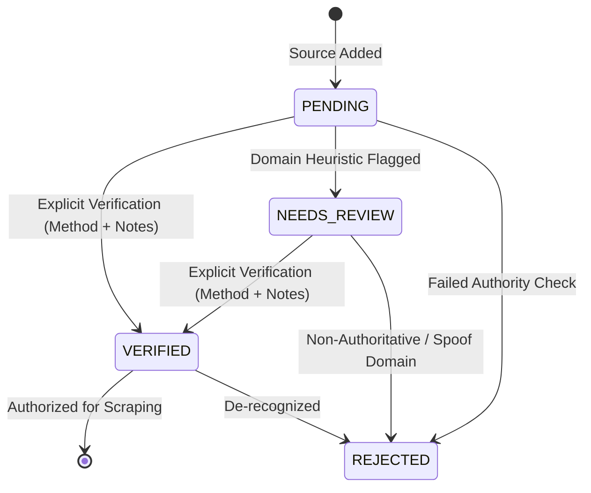

# NEXO Data Platform - Official Government Source Registry Specification

This document details the architecture, governance model, authority hierarchy, and validation standards for the **Official Government Source Registry** of the **NEXO Data Platform**.

---

## 1. Why NEXO Needs an Authoritative Source Registry

NEXO is designed to provide trusted, accurate, multilingual government information and legal assistance to citizens, farmers, cooperatives, and rural enterprises.
Allowing unvetted or third-party web portals into the ingestion pipeline introduces critical risks:
* **Hallucination of Government Rules**: Outdated or speculative interpretations of welfare policies.
* **Financial and Legal Fraud**: Phishing sites, unofficial middleman portals, and commercial loan scams masquerading as government welfare.
* **Outdated Entitlements**: Subsidies or eligibility criteria that have been superseded by newer gazettes.

To maintain statutory trust, **NEXO enforces a zero-trust ingest policy**: only official portals registered and explicitly marked as `VERIFIED` in the Official Source Registry are authorized for data collection.

---

## 2. Source Authority Hierarchy

Official sources are categorized into 6 distinct administrative and statutory tiers:

| Authority Level | Scope & Description | Examples |
| :--- | :--- | :--- |
| `CENTRAL_GOVERNMENT` | Union Government ministries, departments, and apex schemes | Ministry of Agriculture, Ministry of Cooperation, PM-KISAN, Digital India |
| `STATE_GOVERNMENT` | State/UT Government secretariats, state departments, and state welfare schemes | State Agriculture Departments, State Cooperative Registrar Portals |
| `DISTRICT_GOVERNMENT` | District Collectorates, Zilla Parishads, and local administration portals | District portal (`<district>.nic.in`), DRDA |
| `GOVERNMENT_INSTITUTION` | Apex public financial, research, and technical institutions | NABARD, RBI, ICAR, SFAC, NCDC |
| `STATUTORY_BODY` | Autonomous regulatory, constitutional, and dispute redressal bodies | FSSAI, NALSA (Legal Services Authority), CCI, Warehousing Development Authority |
| `OTHER_OFFICIAL` | Recognized public-private partnerships or multi-state cooperative federations | NAFED, KRIBHCO, IFFCO, Amul (statutory federations) |

---

## 3. Verification Workflow



### Verification States:
1. `PENDING`: Initial discovery or proposed intake. Scrapers **cannot** collect data from pending sources.
2. `NEEDS_REVIEW`: Flagged by anti-spoofing heuristics (e.g. general TLDs, commercial domains, or hosts containing "gov" without official `.gov.in` / `.nic.in` backing).
3. `VERIFIED`: Officially approved with auditable verification method and notes. Scrapers **can** collect data.
4. `REJECTED`: Disqualified, unverified third-party, or deceptive website. Completely blocked.

> [!IMPORTANT]
> **No Automatic Verification**:
> A source cannot transition to `VERIFIED` automatically. The system strictly rejects any attempt to set `VERIFIED` status unless both `verification_method` and `verification_notes` are provided.

---

## 4. Domain Categories

All sources are categorized into the 7 core NEXO domains using machine-readable slugs:

1. `government_schemes`: Direct benefit transfers, welfare initiatives, pensions, social security.
2. `cooperative_governance`: Primary Agricultural Credit Societies (PACS), cooperative bylaws, multi-state cooperatives.
3. `agriculture_rural_sustainability`: Crop insurance, soil health, irrigation, sustainable farming practices.
4. `foodtech_coldchain`: Food processing subsidies, rural logistics, cold storage infrastructure.
5. `rural_development_finance`: SHG bank linkages, livelihood missions (NRLM), rural housing.
6. `legal_assistance`: Lok Adalats, legal aid clinics, land dispute mechanisms, consumer forums.
7. `multilingual`: Cross-cutting multilingual gazettes, regional statutory translations.

---

## 5. Source Record Structure

Each registered source is represented by a `SourceRecord`:

| Field | Type | Required | Description |
| :--- | :--- | :--- | :--- |
| `id` | `str` (UUID) | Yes | Unique source identifier |
| `source_name` | `str` | Yes | Human-readable title of the portal / department |
| `organization_name`| `str` | Yes | Official parent ministry, department, or body |
| `official_url` | `str` | Yes | Canonical entry URL |
| `normalized_url` | `str` | Yes | Normalized, deduplicated URL string |
| `domain_category` | `str` | Yes | One of the 7 official machine-readable slugs |
| `authority_level` | `str` | Yes | One of the 6 authority tiers |
| `country` | `str` | Yes | Country code (default `'IN'`) |
| `state` | `str` | No | State name (for state/district level sources) |
| `language` | `str` | Yes | Primary portal language (`'en'`, `'hi'`, etc.) |
| `verification_status`| `str` | Yes | `PENDING`, `VERIFIED`, `REJECTED`, `NEEDS_REVIEW` |
| `verification_method`| `str` | Conditional | Method used to verify authority (required for `VERIFIED`) |
| `verification_notes` | `str` | Conditional | Auditable rationale (required for `VERIFIED`) |
| `is_active` | `bool` | Yes | Operational toggle for automated ingest |
| `last_verified_at` | `str` (ISO) | Conditional | Timestamp when status was set to `VERIFIED` |
| `last_checked_at` | `str` (ISO) | No | Timestamp of latest connectivity or crawler run |
| `created_at` | `str` (ISO) | Yes | Registration timestamp |
| `updated_at` | `str` (ISO) | Yes | Last modification timestamp |

---

## 6. Validation & Anti-Spoofing Rules

1. **Protocol & Host**: URLs must use `http` or `https` with a non-empty host.
2. **URL Normalization**:
   - Schemes and hosts are lowercased.
   - Default ports (`:80`, `:443`) are stripped.
   - URL fragments (`#...`) are removed.
   - Query parameters are deterministically sorted.
   - Trailing path slashes are removed (`/schemes/` -> `/schemes`).
3. **Duplicate Detection**: The registry prevents duplicate entries by comparing normalized URLs.
4. **Deceptive Domain Detection**:
   - Domains containing "gov", "nic", or "yojana" on commercial TLDs (`.com`, `.org`, `.net`) are flagged `NEEDS_REVIEW` and blocked from automatic verification.

---

## 7. Deactivation & Auditability

* **Soft Deactivation**: Calling `registry.deactivate_source(id_or_url, reason="...")` sets `is_active = False` and appends the deactivation rationale to `verification_notes`.
* **Permanent Audit Trail**: Manifest records (JSON/JSONL) record who/what changed a status, when, and with what verification method.

---

## 8. Integration with Ingestion & Cloud Deployment

### Collector Integration
When the scraper/collector runs:
1. It queries the registry for active, verified sources: `registry.find_by_status("VERIFIED")`.
2. Documents collected from that source inherit `source_id = source.id` and `target_domain = source.domain_category`.
3. If a source is deactivated or rejected, collector runs for that domain skip it automatically.

### Supabase Schema Alignment
The existing PostgreSQL schema (`001_initial_schema.sql`) defines:
```sql
CREATE TABLE sources (
    id UUID PRIMARY KEY,
    name TEXT NOT NULL,
    url TEXT NOT NULL UNIQUE,
    domain TEXT NOT NULL,
    language TEXT NOT NULL DEFAULT 'en',
    authority_level TEXT NOT NULL,
    last_checked_at TIMESTAMPTZ,
    is_active BOOLEAN NOT NULL DEFAULT true,
    created_at TIMESTAMPTZ NOT NULL DEFAULT now(),
    updated_at TIMESTAMPTZ NOT NULL DEFAULT now()
);
```

#### Documented Schema Gap:
The offline registry tracks additional governance fields:
* `organization_name`
* `country`
* `state`
* `verification_status`
* `verification_method`
* `verification_notes`
* `last_verified_at`

#### Adapter Strategy:
* `SourceRecord.to_supabase_dict()` maps the record cleanly to the existing table columns without requiring immediate database migration.
* An optional extension migration (`scripts/migrations/002_add_source_verification_fields.sql`) can be applied when the user approves cloud deployment.
