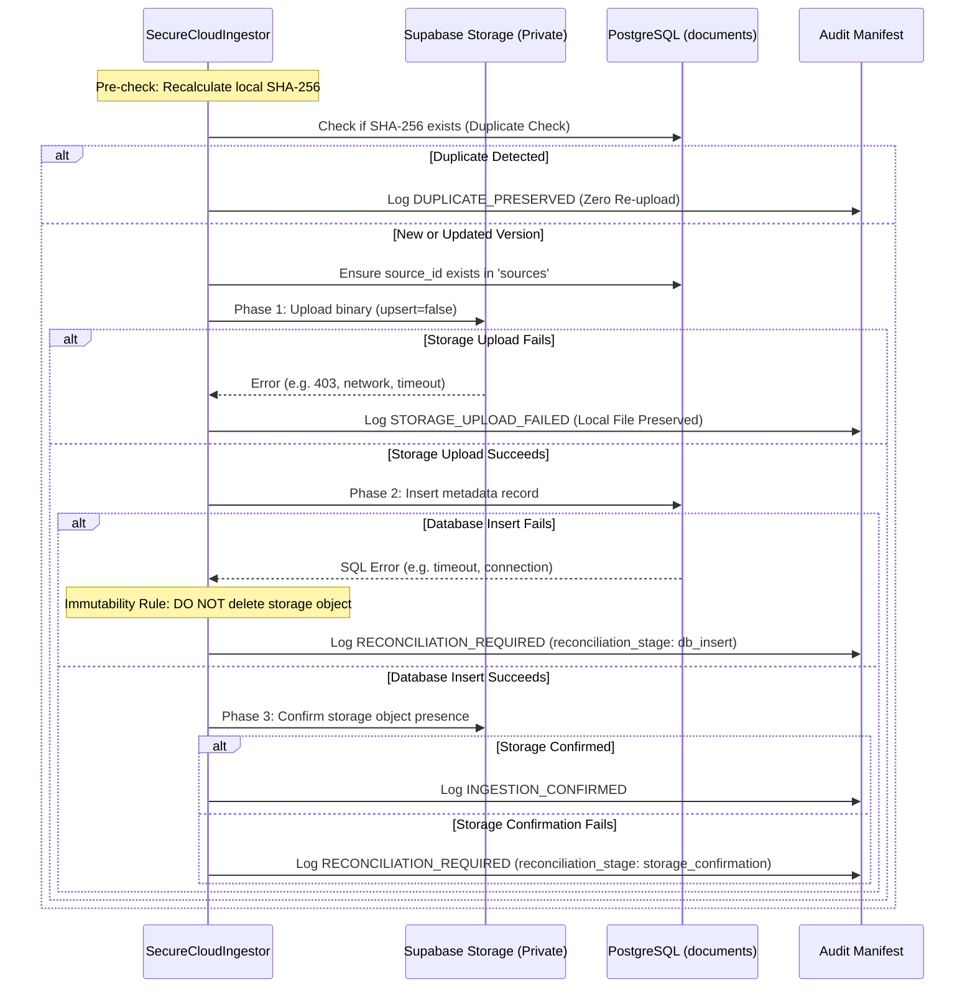

# NEXO Data Platform - Secure Cloud Ingestion Architecture

This document describes the server-side architecture, authentication & authorization model, Row Level Security (RLS) policies, failure recovery protocols, and operational workflows for the **Secure Cloud Ingestion Path** of the **NEXO Data Platform**.

---

## 1. Executive Summary & Security Model

The **Secure Cloud Ingestion Path** bridges the local document discovery & collector pipeline to Supabase Storage and PostgreSQL metadata without compromising security boundaries.

### Trust Boundary Architecture

```mermaid
flowchart TD
    subgraph Untrusted Public Boundary
        A[Client-Side / Frontends / Public] -->|Uses SUPABASE_ANON_KEY| B[Supabase API Gateway]
        B -->|RLS Enforcement| C{Action Allowed?}
        C -- SELECT on active records --> D[Read-Only Access Granted]
        C -- INSERT / UPDATE / DELETE --> E[HTTP 403 / SQL 42501 Denied]
    end

    subgraph Authorized Server-Side Boundary
        F[NEXO Document Collector] -->|Validated & SHA-256 Hashed| G[Local Staging CAS]
        G --> H[SecureCloudIngestor Worker]
        H -->|Uses SUPABASE_SERVICE_ROLE_KEY\n(Isolated Server-Side Env)| I[Supabase Admin Client]
        I -->|Authenticated role: service_role| J[Supabase Storage\nBucket: nexo-government-documents (Private)\nupsert=false]
        I -->|Authenticated role: service_role| K[PostgreSQL\nTable: documents (Strict Schema)]
    end
```

---

## 2. Authentication & Authorization Answers (Requirement 15)

1. **Who/What is allowed to write?**
   Only the authoritative, backend `SecureCloudIngestor` worker running in a trusted, server-side environment. Client-side applications, mobile frontends, and external callers are strictly prohibited from performing write operations.
2. **How does authentication happen?**
   The ingestor initializes an administrative Supabase client using `get_supabase_admin_client()`. Supabase authenticates the request via the signed JSON Web Token (JWT) bearing the `role: "service_role"` claim in the HTTP `Authorization: Bearer <token>` header.
3. **How does authorization happen?**
   PostgreSQL and Supabase Storage evaluate the JWT role claim against Row Level Security policies:
   - On `documents` table:
     ```sql
     CREATE POLICY "Service role full access on documents"
         ON documents FOR ALL TO service_role
         USING (true) WITH CHECK (true);
     ```
   - On `storage.objects`:
     ```sql
     CREATE POLICY "Private bucket - service role and authenticated upload"
         ON storage.objects FOR INSERT
         TO authenticated, service_role
         WITH CHECK (bucket_id = 'nexo-government-documents');
     ```
4. **Which credentials are required?**
   `SUPABASE_SERVICE_ROLE_KEY` (configured in the server-side environment).
5. **Where are credentials stored?**
   Stored exclusively in backend environment variables (`.env` file or cloud secrets manager such as AWS Secrets Manager, GCP Secret Manager, or HashiCorp Vault). Never committed to Git (`.gitignore` protects `.env`), never exposed in client bundles, and never printed in logs or audit manifests.
6. **Why client-side credentials cannot perform this operation:**
   Client-side credentials (`SUPABASE_ANON_KEY` / `SUPABASE_PUBLISHABLE_KEY`) are public secrets discoverable by any browser user. If `anon` were granted write privileges, unauthorized external parties could upload malware, corrupt government gazettes, or delete statutory records. Limiting `anon` strictly to `SELECT` on verified, active data guarantees the integrity and immutability of the platform.

---

## 3. Two-Phase Transactional Intake & Failure Recovery

Distributed ingestion between object storage and relational databases is prone to partial failures. NEXO implements a robust four-step transactional intake flow:



### Partial Failure Scenarios & Guarantees

| Failure Scenario | Immediate Action | Immutability & Safety Guarantee | Recovery Action |
|---|---|---|---|
| **Storage upload fails** | Halts operation before DB insert. | Local staged original file is preserved untouched. | Retry ingestion. |
| **Storage succeeds + DB insert fails** | Logs `RECONCILIATION_REQUIRED`. | Storage object is **never** deleted (prevents accidental CAS corruption). Local file preserved. | Next retry re-verifies storage object existence and safely retries DB metadata insert. |
| **DB insert succeeds + Storage confirmation fails** | Logs `RECONCILIATION_REQUIRED`. | Database record and storage object both preserved. | Operator reconciles via audit manifest or storage verifier. |

---

## 4. Idempotency & Immutability Rules

1. **Deterministic Content-Addressable Storage (CAS)**:
   Storage paths are strictly deterministic:
   ```
   {domain_slug}/{source_id}/{sha256}.{extension}
   ```
2. **Duplicate Ingestion (Identical SHA-256)**:
   - When a document with an already ingested SHA-256 is encountered, it is flagged as `DUPLICATE_PRESERVED`.
   - Zero additional storage bytes are uploaded.
   - The audit log records the verification event with `storage_result.status = "duplicate_preserved"`.
3. **Version Revisions (Updated SHA-256 at Existing URL)**:
   - When an official source publishes an updated document at an existing URL, the new content hashes to a distinct SHA-256.
   - The new document is stored at its own separate CAS path.
   - A new version record is created, referencing `previous_sha256`.
   - The prior version remains permanently accessible and immutable.

---

## 5. Audit Manifest Specification

Every cloud ingestion event is appended to:
- `data/manifests/ingestion/cloud_ingestion_audit.json`
- `data/manifests/ingestion/cloud_ingestion_audit.jsonl`

### Schema Example

```json
{
  "timestamp": "2026-09-14T14:15:00.000000+00:00",
  "document_sha256": "84706492f6369e94d9c906f8b19ef72f4d872c2cca6a98dcf54f182dc40d60db",
  "title": "தமிழ்த்தாய் வாழ்த்து",
  "source_id": "10000000-0000-0000-0000-000000000003",
  "source_name": "Government of Tamil Nadu Official Portal",
  "source_url": "https://www.tn.gov.in",
  "document_url": "https://www.tn.gov.in/sites/default/new_images/tamilthaivazhthusong.pdf",
  "domain": "multilingual",
  "storage_path": "multilingual/10000000-0000-0000-0000-000000000003/84706492f6369e94d9c906f8b19ef72f4d872c2cca6a98dcf54f182dc40d60db.pdf",
  "file_size": 40018,
  "mime_type": "application/pdf",
  "requires_ocr": false,
  "version": 1,
  "storage_result": {
    "uploaded": true,
    "status": "uploaded",
    "storage_path": "multilingual/10000000-0000-0000-0000-000000000003/84706492f6369e94d9c906f8b19ef72f4d872c2cca6a98dcf54f182dc40d60db.pdf"
  },
  "database_result": {
    "inserted": true,
    "status": "confirmed",
    "id": "3e1b3bd2-4e2b-4b2a-b99f-26d867d9e06e"
  },
  "final_status": "INGESTION_CONFIRMED",
  "reconciliation_state": {
    "needed": false,
    "stage": null
  },
  "error_message": null
}
```

---

## 6. Operational Runbook & CLI Commands

### 1. Dry-Run Ingestion (Simulated & Safe)
```powershell
python scripts/run_secure_cloud_ingestion.py --dry-run
```
- Completely non-destructive.
- Requires no server-side credentials.
- Simulates CAS pathing, duplicate checks, and metadata preparation.

### 2. Live Controlled Ingestion (Requires Server-Side Credential)
```powershell
python scripts/run_secure_cloud_ingestion.py --live
```
- Requires `SUPABASE_SERVICE_ROLE_KEY` in `.env`.
- Uploads verified documents to private Supabase Storage.
- Inserts metadata into PostgreSQL `documents` table.
- Generates audit records in `data/manifests/ingestion/cloud_ingestion_audit.json`.

---

## 7. Automated Test Suite

Run unit tests for secure cloud ingestion:
```powershell
python -m unittest tests/test_secure_cloud_ingestion.py
```

Run full regression test suite:
```powershell
python -m unittest discover tests
```
