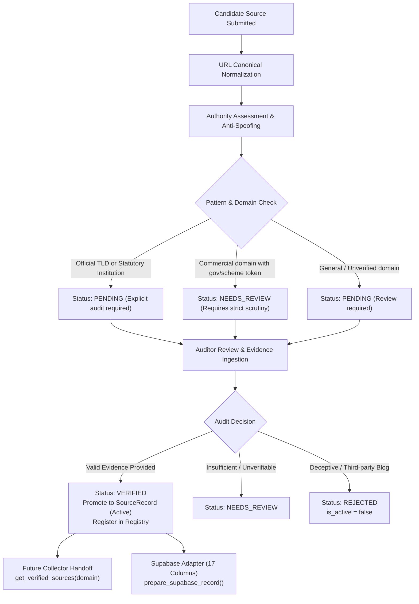

# NEXO Data Platform - Verified Official Source Onboarding Architecture

This document defines the production-ready workflow for onboarding verified official government and institutional information sources into the NEXO Source Registry.

---

## 1. Objective & Design Philosophy

NEXO collects, validates, versions, and manages official government information across 7 focus domains for downstream RAG and a multilingual AI chatbot:
1. `government_schemes`
2. `cooperative_governance`
3. `agriculture_rural_sustainability`
4. `foodtech_coldchain`
5. `rural_development_finance`
6. `legal_assistance`
7. `multilingual`

### Core Tenet: Zero Automatic Verification
Under no circumstances is a website automatically trusted merely because it uses an official top-level domain (`.gov.in` or `.nic.in`) or contains government-sounding terminology. Every source onboarding decision requires **explicit, human-auditable verification evidence**.

---

## 2. Onboarding Lifecycle Architecture



---

## 3. Candidate Source Model (`CandidateSource`)

Every candidate source is ingested via [`CandidateSource`](file:///d:/NEXO_Data_Platform/app/sources/onboarding.py):

| Attribute | Type | Description |
| :--- | :--- | :--- |
| `candidate_id` | `UUID` | Unique tracking identifier for the candidate. |
| `source_name` | `str` | Official name of the portal or service. |
| `organization_name` | `str` | Authoritative ministry, department, or statutory body. |
| `official_url` | `str` | Raw input URL. |
| `normalized_url` | `str` | Canonical normalized URL (scheme lowercased, default ports stripped, query sorted, trailing slash removed). |
| `domain_category` | `DomainCategory` | One of the 7 supported NEXO domain categories. |
| `authority_level` | `AuthorityLevel` | `CENTRAL_GOVERNMENT`, `STATE_GOVERNMENT`, `DISTRICT_GOVERNMENT`, `GOVERNMENT_INSTITUTION`, `STATUTORY_BODY`, or `OTHER_OFFICIAL`. |
| `language` | `str` | Primary language code (e.g. `en`, `hi`). |
| `country` | `str` | ISO country code (default `IN`). |
| `state` | `Optional[str]` | Applicable Indian State/UT for state-level portals. |
| `verification_status` | `VerificationStatus` | Initial lifecycle state: **`PENDING`** (or `NEEDS_REVIEW`). |
| `verification_method` | `Optional[str]` | Official verification evidence type. |
| `verification_notes` | `Optional[str]` | Detailed auditor notes and rationale. |
| `rejection_reason` | `Optional[str]` | Formal reason recorded if rejected. |
| `audit_trail` | `List[Dict]` | Chronological, immutable log of all lifecycle actions and transitions. |
| `submitted_at` | `ISO8601` | Submission timestamp. |
| `updated_at` | `ISO8601` | Last status modification timestamp. |

---

## 4. Verification Evidence & Guardrails

To prevent premature or fraudulent promotion to `VERIFIED`, [`verify_candidate_source()`](file:///d:/NEXO_Data_Platform/app/sources/onboarding.py) enforces strict verification guardrails:

### Accepted Verification Evidence Categories (`VerificationEvidenceType`)
1. **`OFFICIAL_DOMAIN_AUTHORITY`**: Domain ownership verified through official NIC DNS records or Government of India Allocation of Business Rules.
2. **`GOVERNMENT_ORGANIZATION_ID`**: Validated organizational identity registered with Ministry of Home Affairs / DARPG / State Gazette.
3. **`DEPARTMENT_MINISTRY_ASSOCIATION`**: Validated organizational hierarchy directly tied to an apex Union or State Ministry.
4. **`AUTHORITATIVE_PORTAL_RELATION`**: Direct referral link or integration from an apex portal (e.g., `india.gov.in`, `digitalindia.gov.in`).
5. **`CROSS_REFERENCE_GOV_SOURCE`**: Gazette notification, statutory act citation, or Union Cabinet Resolution.
6. **`GAZETTE_NOTIFICATION`**: Official central or state gazette establishing the program, portal, or agency.

### Anti-Spoofing Domain Checks
Commercial or unverified top-level domains containing deceptive tokens (`gov`, `government`, `nic`, `yojana`, `scheme` on `.com`, `.org`, `.in`) are **automatically intercepted** by [`assess_candidate_source()`](file:///d:/NEXO_Data_Platform/app/sources/onboarding.py) and flagged as `NEEDS_REVIEW`. 
- Attempting to verify a suspicious domain requires exhaustive auditor notes (minimum 20 characters) explicitly addressing the domain ownership; otherwise verification is rejected.

---

## 5. Duplicate URL Handling

Candidate sources are evaluated against canonical URLs:
1. The URL is normalized:
   * Schemes/hosts are lowercased.
   * Default ports (`:80`, `:443`) are removed.
   * Fragments (`#section`) are stripped.
   * Query strings are deterministically sorted.
   * Trailing slashes are stripped.
2. If `registry` is passed, [`submit_candidate_source()`](file:///d:/NEXO_Data_Platform/app/sources/onboarding.py) checks if `normalized_url` exists.
3. If an existing registered source shares the normalized URL, the submission is rejected with a descriptive `ValidationError` to prevent duplicate ingestion pipelines.

---

## 6. Audit Trail

Every lifecycle event records an audit entry:
```json
{
  "timestamp": "2026-09-14T18:43:50.123456Z",
  "action": "VERIFIED",
  "status": "VERIFIED",
  "reviewer": "chief_compliance_auditor",
  "method": "OFFICIAL_DOMAIN_AUTHORITY",
  "notes": "Verified via GoI Allocation of Business Rules and NIC DNS records.",
  "reason": null
}
```
Actions tracked:
- `SUBMITTED`: Initial intake.
- `ASSESSED_OFFICIAL_PATTERN`: Recognized government pattern detected.
- `FLAGGED_SUSPICIOUS_DOMAIN`: Anti-spoofing alert triggered.
- `FLAG_NEEDS_REVIEW`: Human reviewer requested further documentation.
- `VERIFIED`: Source approved with full evidence.
- `REJECTED`: Source formally disqualified.

---

## 7. Supabase Adapter (`prepare_supabase_record`)

Formats candidate or registered records to match all 17 columns in the live Supabase PostgreSQL `sources` table:

```python
from app.sources.onboarding import prepare_supabase_record

# Dry run (logs payload without inserting into live Supabase)
payload = prepare_supabase_record(candidate_or_record, dry_run=True)
```

Schema columns prepared:
1. `id` (UUID)
2. `name` (TEXT)
3. `url` (TEXT UNIQUE)
4. `domain` (TEXT)
5. `language` (TEXT)
6. `authority_level` (TEXT)
7. `organization_name` (TEXT)
8. `country` (TEXT)
9. `state` (TEXT NULLABLE)
10. `verification_status` (TEXT)
11. `verification_method` (TEXT NULLABLE)
12. `verification_notes` (TEXT NULLABLE)
13. `is_active` (BOOLEAN)
14. `last_verified_at` (TIMESTAMPTZ NULLABLE)
15. `last_checked_at` (TIMESTAMPTZ NULLABLE)
16. `created_at` (TIMESTAMPTZ)
17. `updated_at` (TIMESTAMPTZ)

---

## 8. Future Collector Handoff Interface

The document ingestion crawler consumes approved sources through [`get_verified_sources()`](file:///d:/NEXO_Data_Platform/app/sources/onboarding.py):

```python
from app.sources.onboarding import get_verified_sources
from app.sources.registry import SourceRegistry

registry = SourceRegistry()

# 1. Fetch all active, verified government schemes sources
scheme_sources = get_verified_sources(registry=registry, domain="government_schemes")

# 2. Fetch all verified cooperative governance sources
coop_sources = get_verified_sources(registry=registry, domain="cooperative_governance")
```

### Strict Collection Guardrails:
* Sources with `is_active = False` are **never** returned (even if previously verified).
* Sources with `verification_status` of `PENDING`, `NEEDS_REVIEW`, or `REJECTED` are **strictly excluded**.
* Downstream scraping workers receive only verified, authoritative official sources.

---

## 9. Manifest Templates

Offline template files are available for batch candidate ingestion:
* [`data/manifests/sources/candidate_sources.json`](file:///d:/NEXO_Data_Platform/data/manifests/sources/candidate_sources.json)
* [`data/manifests/sources/candidate_sources.jsonl`](file:///d:/NEXO_Data_Platform/data/manifests/sources/candidate_sources.jsonl)

All templates contain placeholder entries prefixed with `REPLACE_WITH_...` and are initialized with `verification_status = "PENDING"`.
